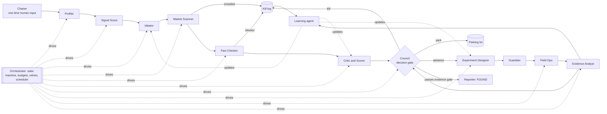

# Multi-agent system for finding a business idea

A design for a system that goes from a founder profile to one evidence-backed business
idea, or to a reasoned "nothing passed", without the founder steering it day to day.

The design follows from the manual run recorded in `ideas/`. That run showed four ways
things go wrong:

- **Ideas generated from desk research were mostly already taken.** 7 of 11 had installed competitors.
- **Facts changed after a decision.** The APER parking-solar obligation dropped from 50 % to 17.5 % (Huwart law), and SIAL access needed a group of 8.
- **Three councils in one day produced three different plans.** Each one was only as good as the facts it was given.
- **A request for "better scores" raised the scores without new evidence.**

Every agent and rule below exists to stop one of these from happening again.

---

## 1. What "done" means

The system stops in exactly one of three states:

| End state | Condition | Output |
|---|---|---|
| **FOUND** | One idea passes the evidence gate (§5): real customers committed money, time or reputation, and no legal or competitive blocker remains | Final dossier: problem, segment, evidence log, competitor map, risks, 90-day plan |
| **EXHAUSTED** | The idea budget (e.g. 40 candidates) or the money/time budget runs out with no idea passing | "Nothing passed" report: every idea killed, the reason, and the constraints learned for the next run |
| **BLOCKED** | A hard gate needs a human (§9), e.g. signing a contract or spending above the charter | A single, precise question to the founder. Everything else is paused, not lost |

"Without me touching it" means the founder signs a **charter** once at the start. After
that, the system runs until one of these three states. The founder may read the weekly
digest but never has to act.

---

## 2. Design principles

1. **Look for competitors before scoring.** Nobody is allowed to score an idea that has not been through the Market Scanner.
2. **Every load-bearing fact needs a source and a date.** A claim without a source cannot drive a decision.
3. **Decisions can only change on new evidence.** To reverse a decision, an agent must cite evidence IDs that did not exist when the decision was made. "Someone pushed back" is not evidence.
4. **Scores are predictions, and predictions get graded.** Nobody can ask for a higher score. Scores move only when evidence moves them, and they are compared later with what actually happened.
5. **Run the cheapest test that could kill the idea.** Each idea has one "kill question", and the next experiment targets it.
6. **Deterministic code orchestrates, LLM agents judge.** Scheduling, budgets, retries, schema validation and state are plain code. Agents never control the loop.
7. **Every external action goes through the Guardian.** Nothing reaches a real person, a payment or a public page without a policy check.

---

## 3. Architecture



### Shared state (the only way agents communicate)

| Store | Content | Written by |
|---|---|---|
| **Idea ledger** | One record per idea: stage, hypotheses, kill question, scores and their confidence, status | Ideator, Scorer, Council |
| **Evidence store** | Atomic facts. Each has an id, the claim, source URL, date retrieved, source tier, confidence, and whether it is a fact or an opinion | Scanner, Fact Checker, Evidence Analyst |
| **Decision log** | Every gate decision, with the evidence ids it relied on | Council |
| **Playbook memory** | Templates, response rates, source reliability, kill-reason taxonomy, rubric versions | Learning agent |
| **Run log** | Every agent call: inputs, outputs, cost, errors | Orchestrator |

Everything is stored as versioned files (in this repo: `ideas/<idea>/` plus JSON next to
it), so a crash can resume and every decision can be audited.

### The handoff envelope

Every agent receives and returns one of these:

```json
{
  "task_id": "faconniers/scan/2026-10-10T09:12",
  "idea_id": "faconniers",
  "stage": "market_scan",
  "inputs": { "...": "stage-specific payload" },
  "evidence_refs": ["ev_0412", "ev_0419"],
  "output": { "...": "stage-specific payload, validated against a JSON schema" },
  "decision": "advance | kill | park | retry | escalate",
  "reason": "one sentence",
  "confidence": 0.0,
  "predictions": [{"claim": "≥3/8 co-packers accepted a small project in 12 months", "p": 0.35, "resolves_by": "2026-10-31"}],
  "cost": {"tokens": 0, "eur": 0}
}
```

The orchestrator rejects any envelope that does not validate. The `predictions` field is
what the Learning agent grades later (§8).

---

## 4. The agents

| # | Agent | Receives | Decides | Passes on |
|---|---|---|---|---|
| 0 | **Orchestrator** (code, not an LLM) | Charter, ledger state, budgets, clock | Which task runs next, retries, timeouts, budget stops, end state | Task envelopes to agents; digest triggers |
| 1 | **Profiler** | Charter, founder files (`CLAUDE.md`) | The **constraint set**: geography, budget, skills, conflicts of interest (e.g. EDF loyalty → no energy-retail competitor), time windows, values | Constraint set + an explicit list of unknowns (e.g. "team skills unknown → assume no developer") |
| 2 | **Signal Scout** | Constraint set, playbook (which signal types produced survivors before) | Which **change signals** are real: new regulations, deadlines, budget cuts, models proven abroad, recurring complaints | 20–50 signals, each with a citation and a date |
| 3 | **Ideator** | Signals, constraints, **negative constraints** learned from past kills | Candidate ideas, built from explicit remix operators (proven elsewhere × new trigger × outcome pricing × team edge) | Each idea as hypotheses (who suffers, who pays, why now, the riskiest assumption). **No scores** |
| 4 | **Market Scanner** | One idea | Competitive verdict: *crowded*, *validated with a gap*, *open*, or *suspiciously open* (open may mean illegal, unpaid or too small). It must check software vendors, services, public bodies, **informal intermediaries** (associations, networks) and foreign analogues | Competitor map with evidence ids. Kills *crowded-without-wedge* ideas directly |
| 5 | **Fact Checker / Regulatory** | The idea's load-bearing claims | Whether each claim is verified (2 independent sources or 1 official), contested or false. Source hierarchy: official journal or law > government > reputable press > vendor blogs. Flags blockers (licences such as Hoguet, health-data hosting, conflicts of interest) | Verified claims, contradictions, and blockers (a blocker kills or parks the idea) |
| 6 | **Critic and Scorer** | Idea + verified evidence only | Scores on the rubric, **each with a confidence interval**. Runs a pre-mortem, an assumption map, a red team and an inversion, then names **the single kill question** | Scored idea, kill question, and predictions it will be graded on |
| 7 | **Council** (5 lenses + anonymous peer review + chair) | 3–8 scored ideas and the decision log | **advance**, **kill** or **park** for each idea, with dated stop criteria. Cannot reverse a previous decision without new evidence ids | Decisions logged; the advanced ideas go to the Experiment Designer |
| 8 | **Experiment Designer** | Advanced idea + its kill question + playbook | The **cheapest valid test**: written async interview (Mom Test), concierge offer, smoke-test landing page with pre-order, data pull, expert call. Fixes sample size, channel, pass/kill thresholds and deadline | Experiment spec: target list criteria, message templates, script, thresholds |
| 9 | **Guardian** (policy agent + hard-coded rules) | Every outbound action | Allow, modify or block, based on: truthful identity (says it is a student project and AI-assisted), opt-out in every message, GDPR basis, rate limits, spend caps, no health or personal data collected, no impersonation, no promises or contracts | The approved action, or a block with its reason (logged) |
| 10 | **Field Ops** | Approved experiment spec | Builds prospect lists from open data, sends outreach, follows up (D+3, D+7), runs async written interviews, publishes the landing page, records every reply | Raw responses, response rates, commitments (meeting booked, intro, deposit, letter of intent) |
| 11 | **Evidence Analyst** | Raw responses | Separates **facts** (past behaviour, money spent) from **opinions** and compliments. Places each commitment on the time/reputation/money ladder and updates the idea's pass probability | Coded evidence + belief update → back to the Council at the dated gate |
| 12 | **Learning agent** | Kill log, decision log, graded predictions, run log | What to change in prompts, rubrics, playbooks and negative constraints (§8) | Versioned updates. Each one goes live only after passing the regression evals |
| 13 | **Reporter** | Ledger | Nothing. It only writes | Weekly read-only digest; final FOUND or EXHAUSTED dossier |

### How the skills already in this repo map to agents

| Agent | Skill (`.claude/skills/`) |
|---|---|
| Ideator | `ai-startup-opportunity-generator`, `brainstorm-ideas-new`, `jobs-to-be-done` |
| Market Scanner | `ai-startup-opportunity-generator` (competitor audit mode) + web search |
| Critic and Scorer | `identify-assumptions-new`, `lean-canvas`, `market-sizing`, `beachhead-segment` |
| Council | `llm-council` |
| Experiment Designer, Evidence Analyst | `mom-test` |
| Reporter | `startup-design` (Fast Track structure) |

---

## 5. Life of one idea: the gates

```
GENERATED → SCANNED → VERIFIED → SCORED → [COUNCIL] → TESTING → [COUNCIL] → FOUND
     ↘ killed     ↘ killed     ↘ killed      ↘ park/kill         ↘ kill / pivot (= new idea)
```

| Gate | Pass condition | Typical kill reason |
|---|---|---|
| Scan | Not *crowded-without-wedge* | "10+ vendors, nothing to differentiate" (e.g. the tender-writing software) |
| Verify | No unresolved blocker; every load-bearing claim verified | "The rule changed" (e.g. APER cut to 17.5 %) |
| Score | Lower bound of the composite score ≥ 6.0 **and** a kill question that can be tested in ≤ 3 weeks | "Can't be tested cheaply" |
| Council #1 | Advance at most 3 ideas at a time | — |
| Evidence gate | **≥ 3 of N** targets show the paid-already behaviour **and** ≥ 1 money or reputation commitment (deposit, letter of intent, intro to a buyer) **and** the kill question answered favourably | "Nobody has ever paid for this" |
| FOUND | Evidence gate passed + unit economics sanity check + legal path identified | — |

**Pivots are new ideas.** A pivot gets a new ledger id and goes back through the Scan and
Verify gates. A pivot cannot skip the gates its parent passed.

---

## 6. Error handling

| Failure | Detection | Response |
|---|---|---|
| Tool or network error (search, fetch, email) | Exception or timeout | Retry with exponential backoff (2/4/8/16 s), then switch to an alternate provider or source. If still failing, mark the task `degraded` and continue on other ideas. Never block the whole run |
| Malformed agent output | JSON schema validation | Up to 2 repair passes ("your output failed: <errors>"). Then re-run on a stronger model. Then quarantine the task and alert in the digest |
| Hallucinated or unsourced fact | Fact Checker: no URL, the URL does not contain the claim, or the date is stale | Confidence set to 0, so the claim cannot be load-bearing. Repeated offenders lower the agent's source-trust weight |
| Contradicting sources | Two verified claims disagree | Mark the claim `contested`. Use the source hierarchy. If it is still unresolved and load-bearing, it becomes the experiment's question |
| Decision flip-flop | A Council reversal cites no new evidence ids | Rejected by the orchestrator. Councils are capped at 1 per idea per gate |
| Agents disagree | The Council splits | The chair must decide. On a true tie, the cheapest test that separates the two sides wins |
| Outreach gets no replies | Response rate below the floor after D+7 | Change channel (email → LinkedIn → association/intermediary). After 2 channels fail, log "segment unreachable". That counts as evidence (go-to-market risk), not as noise |
| Real-world constraint discovered late (e.g. trade-show access) | Field Ops or Fact Checker | Fall back to the plan B listed in the experiment spec. Every spec must have a plan B before it runs |
| Runaway cost or loops | Per-task, per-idea and global budgets; maximum iterations | Circuit breaker stops the branch. The digest explains where the budget went |
| Policy violation attempt | Guardian | Block, log, and send the agent's next attempt back with the rule cited. Three blocks in a row escalate to BLOCKED |
| Crash | Orchestrator heartbeat | State is event-sourced and every step is idempotent, so the run resumes from the last checkpoint with no duplicate emails (sends are keyed by `task_id`) |

---

## 7. What can run unattended, and what cannot

The founder's **only** touch is the **charter**, signed once:

```yaml
charter:
  founder_profile: CLAUDE.md
  geography: France
  budget_eur: 300            # landing pages, small ads, domain
  max_ideas: 40
  deadline: 2026-12-15
  outreach:
    identity: "Students from <school>, AI-assisted research project"
    sender: research@<team-domain>   # never a personal or employer address
    max_new_contacts_per_day: 30
  forbidden:
    - competing with the founders' employers (loyalty clauses)
    - collecting health or patient data
    - accepting money before a legal entity exists (pre-orders = refundable letters of intent only)
    - live AI phone calls to real people
  auto_approved: [web research, open-data lists, B2B email outreach, async written interviews, landing page + refundable pre-order]
```

Anything outside `auto_approved` produces a **BLOCKED** state with one question. That is
deliberate. Some things should never be fully unattended:

- signing anything;
- taking real money;
- live calls in the founder's name;
- anything that could breach an employment contract.

The rest runs alone.

---

## 8. How it improves itself

| Mechanism | What it learns from | What changes |
|---|---|---|
| **Kill-reason taxonomy → negative constraints** | Every kill is classified (crowded, illegal, unreachable, nobody pays, rule changed, team mismatch...) | The Ideator receives rules such as "don't propose software in categories with comparison sites" or "always check informal intermediaries and public substitutes". Ideas killed for a known reason should get rarer each cycle |
| **Prediction grading (calibration)** | Every agent's `predictions` field, resolved by later evidence | A Brier score per agent and per rubric dimension. If the Scorer's "pain 8" ideas keep failing the evidence gate, the rubric weights and anchors are adjusted. Overconfident agents get wider intervals by default |
| **Source reliability** | Facts later contradicted (e.g. blogs repeating an outdated 2024 deadline) | Each domain's trust weight goes down, and the Fact Checker needs more corroboration from it |
| **Playbook bandit** | Outreach response and commitment rates per template, channel, hour and segment | A multi-armed bandit shifts traffic to the best-performing variants. Weak variants are retired |
| **Signal yield** | Which signal types led to survivors | The Signal Scout spends more of its budget on productive signal types |
| **Prompt and rubric versioning with regression evals** | A golden set built from past runs | A new prompt goes live only if it passes the golden set. Examples from this run: the tender-writing idea must be flagged *crowded*; Foncier Solaire must catch the Huwart change; Bouclier IDEL must find the coding checks already built into billing software; a request for "higher scores" must not move any score |
| **Retrospective after each end state** | The whole run log | The Learning agent writes a short retrospective and proposes changes. The orchestrator applies only those that pass the evals |

**Guard against gaming the metric.** No agent is rewarded for high scores or for
advancing ideas. Agents are rewarded only for **calibration** (predicted vs actual) and
**cost per verified insight**. That removes the incentive to inflate.

---

## 9. Implementation sketch

- **Orchestrator:** a small state machine in Python or TypeScript, or a Claude Agent SDK
  app, triggered by a scheduler (e.g. a cloud routine every hour). Each tick reads the
  ledger, picks the highest-priority runnable task, dispatches it, validates the result
  and commits state to git.
- **Agents:** one system prompt + JSON schema + tool allow-list each.
  - Research agents: web search and fetch.
  - Field Ops: email API, landing-page host, open-data APIs (e.g. `annuaire-entreprises.data.gouv.fr`).
  - Council: runs as parallel calls, as `llm-council` does today.
- **Models:** the strongest model for the Council chair, the Critic and the Fact Checker. A cheaper, faster model for bulk scanning and coding replies.
- **Storage:** this repo. `ideas/<id>/` holds the human-readable files, and `state/` holds the JSON ledger, evidence store and decision log.
- **Observability:** weekly digest (funnel counts, kills by reason, budget used, calibration chart) published read-only.

---

## 10. Replaying the manual run (09/10/2026) through this design

| What happened by hand | What the system would have done |
|---|---|
| v1 ideas looked random; the user asked for "better scores" | The Ideator works from cited signals with remix operators. The request for higher scores is logged and ignored; only evidence moves scores |
| Council #1 chose Mémoire Gagnant, and the market scan then found Tenderbolt, Maître AO, Olra... | The Scanner runs **before** scoring, so the idea dies at the Scan gate. Council #1 never sees it |
| Foncier Solaire was scored 7.45 on an outdated 50 % rule | The Fact Checker requires an official source dated after the latest amendment, so the Huwart law (17.5 %) is caught at Verify |
| Bouclier IDEL went abandoned → promoted → frozen in one day | The reversal cites no new evidence ids, so the orchestrator rejects it. IDEL stays at its gate until its experiment resolves |
| The SIAL plan failed on access rules | The experiment spec requires a verified access path and a plan B before Field Ops runs |
| Three councils in one day | Maximum 1 council per idea per gate. The next decision is triggered by evidence, not by a new conversation |

Applying this design to today's three live ideas, the system would now be in **TESTING**:
- **Façonniers:** async outreach to a hand-qualified co-packer list, testing the kill question about small projects.
- **Alterno:** a written legal question, and nothing else until the reply.
- **Bouclier IDEL:** a desk check of its competitors (unions, insurers' legal protection), then a written survey through nurses' unions.

It would decide on 31 October and 6 November without anyone having to ask.
